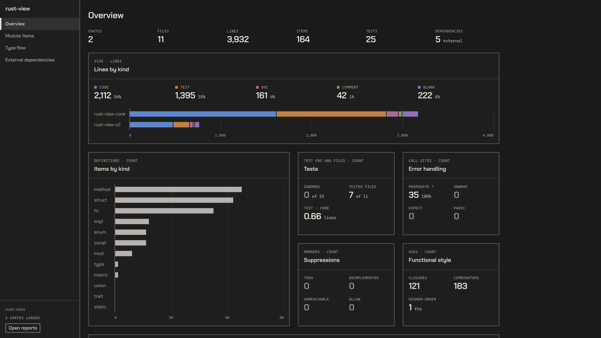
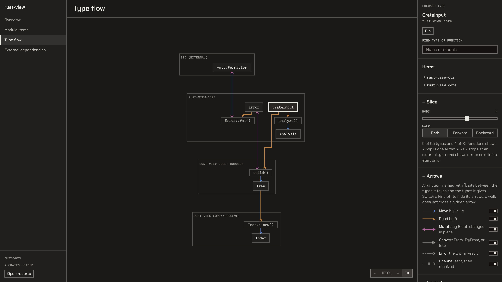

# rust-view

cargo project metricization & visualization dashboard.

features:

- a metrics overview of the codebase
- a module tree & export/re-export display
- a type flow graph (shows how functions transform types)
- an external dependency graph

## showcase

### overview page



### type flow page



## setup

requires:

- [rust](https://rustup.rs) (1.85+)
- [bun](https://bun.sh) (only to build)

run:

```sh
# FIRST: dashboard (cli emeds it)
(cd web && bun install && bun run build)

# SECOND: `rust-view` cli in `~/.cargo/bin
cargo install --path crates/cli --locked
```

- `~/.cargo/bin` must be in `PATH` (rustup sets this up).

## usage

```sh
# gen report & open dashboard
rust-view . --open

# only gen reports
rust-view .

# only open dashboard
rust-view --open
```

reports go in `~/.rust-view` (override with `$RUST_VIEW_HOME`).
